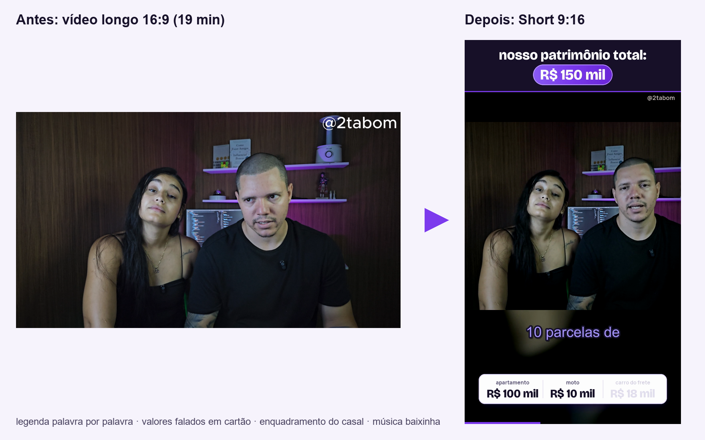
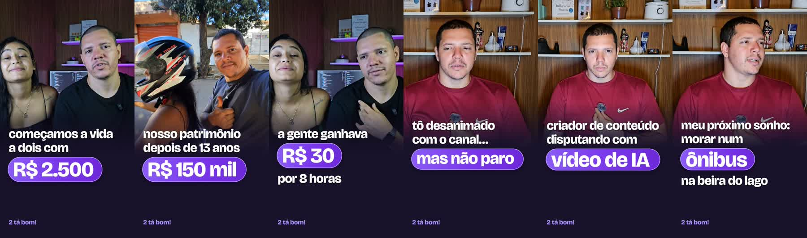
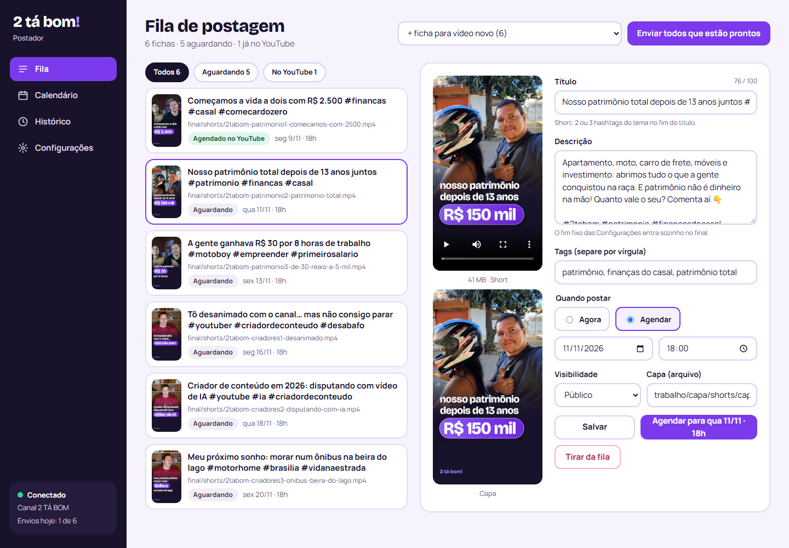
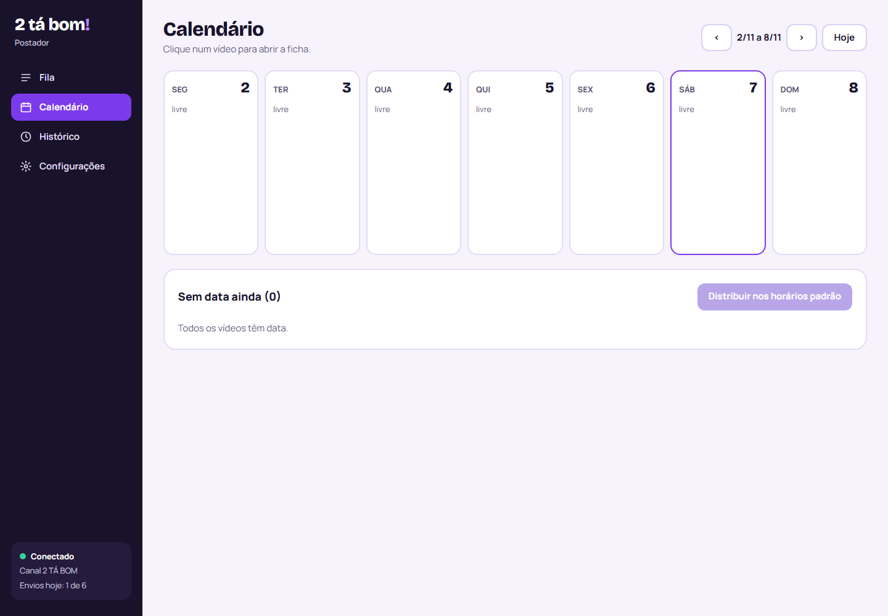
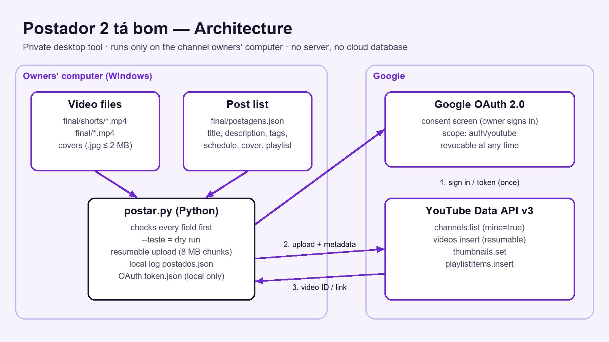

# Estúdio de vídeos

Ferramentas em **Python** que transformam um vídeo longo do YouTube em **Shorts prontos para postar** e um painel web
local que **publica e agenda** esses vídeos pela **YouTube Data API v3**. Feito para o canal
[2 TÁ BOM](https://www.youtube.com/@2tabom) (vida real e finanças de um casal de Brasília).



> **EN —** Python tooling that turns a long YouTube video into ready-to-post Shorts (Whisper transcription,
> silence-based cuts, vertical reframing, word-by-word animated captions, money cards, auto-generated covers) and a
> local web dashboard that uploads and schedules them through the YouTube Data API v3 (OAuth 2.0, resumable upload).

---

## O que tem aqui

### 1. Fábrica de Shorts (`shorts/`)
Do vídeo bruto ao Short vertical de 60–90 s, no visual do canal:

| Etapa | Arquivo | Como |
|---|---|---|
| Transcrição com o tempo de cada palavra | `transcrever.py`, `palavras.py` | OpenAI **Whisper** (local), `word_timestamps` |
| Escolha dos trechos e corte das pausas | `cortes_pelo_som.py`, `cortes.py`, `mapa.py` | **FFmpeg** `silencedetect` (decide pelo som, não só pelo texto) |
| Enquadramento vertical 1080×1920 | `base.py` | recorte no rosto; **modo largo** para duas pessoas lado a lado, com o próprio vídeo desfocado atrás |
| Legenda palavra por palavra, cartões de valores, barra de progresso, música | `render.py` | **Pillow** gera as camadas, legenda **ASS** com karaokê (`\k`), mixagem e **loudnorm** −14 LUFS no FFmpeg |
| Capa própria de cada Short | `capa_short.py` | Pillow + PhotoCraft CLI (arquivo em camadas editável) |
| Capa dentro do vídeo (para escolher no app) | `capa_no_fim.py` | FFmpeg `concat` com 0,5 s da arte no fim |



### 2. Postador (`postador/`)
Sobe e agenda vídeos no canal sem abrir o YouTube Studio.

- `postar.py` — linha de comando: `--lista`, `--teste` (confere tudo sem enviar), envio de um ou vários vídeos.
  - **OAuth 2.0** (app para computador; o token fica só na máquina)
  - **envio retomável** em pedaços de 8 MB, com nova tentativa automática se a internet cair
  - título, descrição, tags, idioma, "não é para crianças", **publicação agendada** (`publishAt`), capa (`thumbnails.set`), playlist
  - validações antes de enviar: limite de 100 caracteres, hashtags do tema no título, capa ≤ 2 MB, data no futuro,
    cota diária, **nunca posta o mesmo vídeo duas vezes**
- `painel/` — **painel web local** (servidor HTTP em Python puro, sem framework + HTML/CSS/JavaScript sem bibliotecas):
  fila com prévia do vídeo e da capa, edição das fichas, confirmação antes de cada envio, barra de progresso,
  calendário semanal, histórico e configurações. Liga junto com o Windows (`pythonw`, sem janela).




### Arquitetura


---

## Tecnologias
**Python 3.12** · **YouTube Data API v3** · **Google OAuth 2.0** (`google-auth-oauthlib`, `google-api-python-client`) ·
**FFmpeg** (filtros, concat, ASS, loudnorm) · **OpenAI Whisper** · **Pillow** · `http.server` (servidor sem framework) ·
**HTML, CSS e JavaScript** puros · GitHub Pages (política de privacidade e termos do app).

## Como rodar

```bash
pip install google-api-python-client google-auth-oauthlib openai-whisper pillow
```
FFmpeg precisa estar no PATH.

**Postador**
1. Crie um projeto no Google Cloud, ative a *YouTube Data API v3* e baixe um *ID do cliente OAuth* do tipo
   "App para computador" como `postador/credencial.json`.
2. `python postador/postar.py --conectar` (abre o login do Google uma vez).
3. Copie `exemplos/postagens.exemplo.json` para `final/postagens.json` e coloque os vídeos em `final/`.
4. `python postador/painel/servidor.py` → http://localhost:8787

**Shorts**
1. Vídeo em `bruto/`; trechos em `trabalho/shorts/shorts.json` (ver `exemplos/shorts.exemplo.json`).
2. `cortes_pelo_som.py` → `base.py` → `palavras.py` → `render.py` (cartões em `exemplos/short-cartoes.exemplo.json`).

> Projetos novos da API do YouTube enviam vídeos como **privados** até passarem pela auditoria do Google
> (YouTube API Services Audit). Este projeto já fez o pedido.

## Estrutura
```
postador/           postar.py, config.json e o painel web (painel/)
shorts/             etapas da fábrica de Shorts
exemplos/           arquivos de exemplo (fichas de postagem, trechos, cartões)
fontes/             Bricolage Grotesque e Manrope (licença OFL)
docs/               imagens deste README
```

Credenciais, tokens, vídeos e dados do canal **não** estão no repositório (ver `.gitignore`).

---
Feito por [Luciano Fonseca](https://github.com/lucianofonsecadev) para o canal 2 TÁ BOM.
